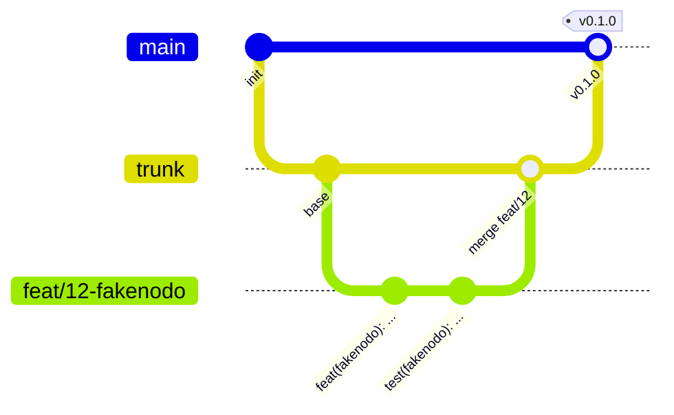

# Acta Fundacional — Esports-hub

- **Universidad:** Universidad de Sevilla — Escuela Técnica Superior de Ingeniería Informática (ETSII)
- **Titulación:** Grado en Ingeniería Informática – Ingeniería del Software
- **Asignatura:** Evolución y Gestión de la Configuración (Curso 2026/2027)
- **Equipo:** Esports-hub
- **Hub:** Partidos de Esports en CSV
- **Tutor/a:** Jesús Moreno León
- **Lugar y fecha:** Sevilla, 9 de noviembre de 2026

---

## 1. Introducción

Este documento recoge los acuerdos que rigen el funcionamiento del equipo **Esports-hub** en la asignatura *Evolución y Gestión de la Configuración* durante el curso 2026/2027. El proyecto parte de un fork de **UVLHub** y tiene como objetivo adaptarlo a un nuevo dominio y añadirle nuevas funcionalidades de forma colaborativa, ordenada y trazable.

Cualquier modificación de estos acuerdos deberá aprobarse en reunión de equipo y quedar registrada en el diario del equipo (`docs/diario/`).

## 2. Identificación del equipo

- **Nombre del grupo:** Esports-hub
- **Tutor:** Jesús Moreno León
- **Repositorio:** `Repositorio-EGC` (organización `EGC-Esports`)

| Nombre y apellidos | UVUS | Correo electrónico | Usuario de GitHub |
| --- | --- | --- | --- |
| Pedro José Payán Aguilera | `NBD5780` | `ppayan@us.es` | `@ThePayan` |
| David Lozano Acosta | `FBN5868` | `davlozaco@alum.us.es` | `@dlozaco` |
| Raúl Jiménez Pérez | `LSW6941` | `raujimper@alum.us.es` | `@RaulJimPer` |
| Rocío Morato Aguilar | `XTR5967` | `rocmoragu@alum.us.es` | `@Rma816` |
| Rubén López Expósito | `CRP8717` | `rublopexp@alum.us.es` | `@RuLop816` |

**Regla de identidad en Git:** cada integrante debe configurar `git config user.name` y `git config user.email` con exactamente el mismo nombre y correo asociados a su cuenta de GitHub, de modo que todas las contribuciones queden correctamente atribuidas.

## 3. Tipo de hub

Dentro del Work Item común **WI-newdataset (#178)**, el equipo desarrollará un hub de **partidos de Esports en formato CSV** procedentes principalmente de Kaggle, con información de partidas, rondas, equipos, ganador, fecha y estadísticas de jugadores (centrado inicialmente en partidas profesionales de Valorant, según [DEC-001](../decisiones/DEC-001-dominio-valorant.md)).

## 4. Work Items

Los 7 Work Items asignados al equipo y su reparto de responsabilidades son:

| Work Item | Issue | Dificultad / Tipo | Responsables |
| --- | --- | --- | --- |
| WI-newdataset | `#178` | Común | Todo el equipo (coordinador por definir en la firma del acta) |
| WI-fakenodo | `#177` | Común | Todo el equipo (coordinador por definir en la firma del acta) |
| Two-factor authentication (2FA) | `#200` | Alta | Pedro José Payán Aguilera, Rocío Morato Aguilar, David Lozano Acosta |
| Active session management | `#202` | Alta | Raúl Jiménez Pérez, Rubén López Expósito, David Lozano Acosta |
| Automatic dataset recommendations | `#209` | Media | Raúl Jiménez Pérez, Rocío Morato Aguilar |
| Download own dataset | `#184` | Media | Rubén López Expósito, Pedro José Payán Aguilera |
| Trending datasets | `#211` | Baja | Rocío Morato Aguilar |

> **Nota de planificación:** En el documento `Planificacion_WIs_Issues_Esports_Hub` se propuso asignar la coordinación de `#178` (WI-newdataset) a Pedro José Payán Aguilera y la de `#177` (WI-fakenodo) a David Lozano Acosta.

## 5. Roles y responsabilidades

| Rol | Responsable | Responsabilidades principales |
| --- | --- | --- |
| **Project Manager** | Pedro José Payán Aguilera | Organiza y convoca las reuniones, mantiene actualizado el tablero de tareas, redacta las actas y es el contacto principal con el tutor. |
| **DevOps** | David Lozano Acosta | Se encarga de los workflows de GitHub Actions, los contenedores Docker y los despliegues, y crea las releases en `main`. |
| **Responsable de calidad** | Pedro José Payán Aguilera | Comprueba que cada tarea tenga sus pruebas, controla la cobertura y verifica las issues antes de cerrarlas. |
| **Desarrollador/a** | Rocío Morato Aguilar, Raúl Jiménez Pérez, Rubén López Expósito | Implementan los Work Items asignados y resuelven las incidencias que vayan surgiendo. Todos los miembros desarrollan al menos un WI con sus pruebas y conocen el funcionamiento general del proyecto. |

**Regla de sustitución:** si alguien no puede asumir su rol de forma temporal o definitiva, se nombrará un sustituto en la siguiente reunión y el cambio quedará reflejado en el diario del equipo.

## 6. Acuerdos de comunicación

- **Microsoft Teams:** canal principal del día a día para avisos, dudas rápidas y convocatorias de reuniones.
- **GitHub Issues:** registro y seguimiento de tareas, incidencias y decisiones técnicas.
- **Correo de la Universidad:** comunicación oficial con el tutor.
- **Reuniones:** idealmente una vez por semana según disponibilidad del equipo, levantando un acta breve en `docs/diario/actas/`.
- **Compromiso de respuesta:** responder en el grupo en un máximo de **24 horas**.

### Hitos y fechas de seguimiento

| Fecha | Hito |
| --- | --- |
| 9 de noviembre de 2026 | Entrega del Acta Fundacional y 1.er seguimiento |
| 23 de noviembre de 2026 | 2.º seguimiento (gestión del código fuente e incidencias, release `v0.1.0`) |
| 30 de noviembre de 2026 | 3.er seguimiento (pruebas automatizadas y CI/CD, release `v0.2.0`) |
| 14 y/o 16 de diciembre de 2026 | Defensa del proyecto (release `v1.0.0`) |

## 7. Política de gestión de ramas

El equipo adopta el flujo de trabajo **EGCFlow**:

### 7.1. Ramas permanentes y de tarea

- **`main`:** solo contiene versiones entregadas, cada una marcada con su etiqueta (`tag`) y su *release* con versionado semántico (`v0.1.0`, `v0.2.0`..., `v1.0.0` para la entrega final), creadas por el responsable de DevOps antes de cada seguimiento.
- **`trunk`:** rama de integración donde se mezcla el trabajo terminado.
- **Ramas de tarea:** se crean siempre desde `trunk` con la nomenclatura `tipo/número-de-issue-descripción` (por ejemplo, `feat/12-fakenodo`, `fix/15-validacion`). Queda prohibido crear ramas por persona.

### 7.2. Ciclo de integración

- Mientras una rama de tarea esté activa, debe actualizarse con `trunk` al menos cada **2 días de trabajo** (`git merge trunk`).
- Solo se integran en `trunk` cuando cumplen los criterios de aceptación, cuentan con sus pruebas y la CI pasa en verde.
- La integración en `trunk` se realiza en local mediante `git merge` (`git merge --no-ff`), sin Pull Requests dentro del equipo (las PR se reservan para proponer cambios a otros equipos).
- Las ramas de tarea se eliminan tanto en local como en remoto tras integrarse en `trunk`.

### 7.3. Política de commits (Conventional Commits)

- Formato obligatorio: `tipo(alcance): descripción (#issue)`.
- Los mensajes deben estar redactados en **español** y corresponder a commits **atómicos**.
- Se referencia la issue con `(#N)` al final del mensaje.

### 7.4. Prohibiciones explícitas

- **Prohibido** hacer commits directos sobre `main`.
- **Prohibido** usar `git push --force` sobre `main` o `trunk`.

## 8. Gestión de incidencias, pruebas y CI/CD

- **Tablero:** GitHub Projects con cuatro columnas: *Pendiente*, *En progreso*, *En revisión* y *Hecho*.
- **Incidencias (GitHub Issues):** cada issue incluye persona asignada, descripción, criterios de aceptación y etiquetas de tipo (`feature`, `bug`, `test`, `ci`, `docs`), prioridad y dificultad. Los *bugs* detallan además pasos para reproducir, resultado esperado y resultado obtenido.
- **Cierre verificado:** cada issue la cierra una persona distinta de quien la implementó tras comprobar que cumple los criterios de aceptación.
- **Estrategia de pruebas:**
  - Pruebas unitarias y de integración con `pytest`.
  - Pruebas de interfaz con `Selenium`.
  - Pruebas de carga con `Locust` en las partes críticas.
  - Prueba de regresión por cada bug corregido.
  - Análisis de calidad y requisitos no funcionales con `SonarQube` / `SonarCloud`.
- **CI/CD y entornos:**
  - Workflows de GitHub Actions (lint, formato de commits y `pytest`) ejecutándose sobre `trunk` y sobre las ramas de tarea (no solo en `main`).
  - Despliegue continuo de `trunk` en preproducción y de las releases de `main` en producción.
  - Credenciales almacenadas únicamente en **GitHub Secrets** (nunca en el repositorio).
  - Entorno común de desarrollo basado en **Docker / Dev Container** con versiones fijas de imágenes y dependencias.

## 9. Régimen interno y sanciones

### 9.1. Normas de obligado cumplimiento

1. Asistir a las reuniones acordadas o avisar con al menos **12 horas** de antelación.
2. Cumplir los plazos de las tareas asignadas y avisar con tiempo si no se van a poder cumplir.
3. Dejar todo el trabajo reflejado en el repositorio y enlazado a su issue correspondiente.
4. Entender y saber explicar el código que cada uno sube al repositorio.
5. Tomar las decisiones por consenso y, si no es posible, por mayoría; en caso de empate, decidirá el Project Manager.

### 9.2. Tabla de incumplimientos y sanciones

| Incumplimiento | Primera vez | Segunda vez | Tercera vez |
| --- | --- | --- | --- |
| Faltar a una reunión sin avisar | Se anota en el acta | Aviso formal del equipo | Se comunica al tutor/a |
| No responder en el plazo acordado | Recordatorio en el grupo | Se anota en el diario | Aviso formal del equipo |
| No entregar una tarea a tiempo sin avisar | Se fija un nuevo plazo | Se reasigna la tarea | Se comunica al tutor/a |
| Una semana sin participar ni dar explicaciones | Reunión con la persona | Se comunica al coordinador | - |

### 9.3. Conflictos graves

Si se produce un conflicto grave, se acudirá lo antes posible al coordinador de la asignatura para que medie o, si fuera necesario, dé de baja al miembro que no participe; las diferencias de opinión sobre el trabajo se intentarán resolver dentro del propio equipo.

## 10. Firmas

Los miembros del equipo declaramos haber leído esta acta y nos comprometemos a cumplir los acuerdos recogidos en ella.

En Sevilla, a 9 de noviembre de 2026.

| Nombre y apellidos | UVUS | Estado |
| --- | --- | --- |
| Pedro José Payán Aguilera | `NBD5780` | Firmado en el documento original |
| David Lozano Acosta | `FBN5868` | Firmado en el documento original |
| Raúl Jiménez Pérez | `LSW6941` | Firmado en el documento original |
| Rocío Morato Aguilar | `XTR5967` | Firmado en el documento original |
| Rubén López Expósito | `CRP8717` | Firmado en el documento original |
